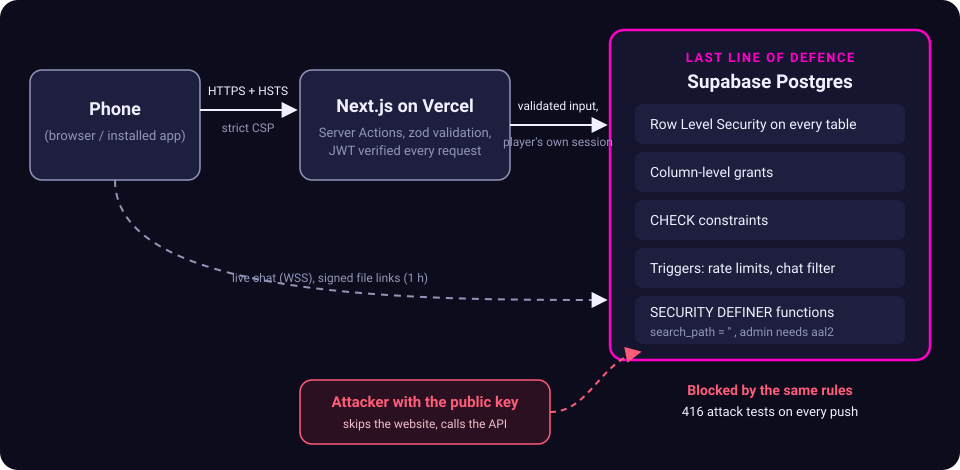

# GameArena: Security Case Study

[](https://github.com/Ghostzw1/gamearena-security-case-study/actions/workflows/security-tests.yml)

**How I secured a real, live mobile esports platform, and proved it with 416 automated attack tests.**

📖 Read it as a website: **[ghostzw1.github.io/gamearena-security-case-study](https://ghostzw1.github.io/gamearena-security-case-study/)** ·
💻 Code and tests: **[GitHub repository](https://github.com/Ghostzw1/gamearena-security-case-study)**

GameArena is a tournament platform for Call of Duty: Mobile players in Southern Africa: accounts, live chat,
clans, country chats, tournaments with squads and results, sponsored events, photo/video sharing, push
notifications and an admin panel. It runs in production on **Next.js + Supabase (Postgres) + Vercel**.

I built it as a self-taught developer moving into cybersecurity, and I treated it as my security training
ground: every feature had to answer *"who could abuse this, and what stops them?"* before it shipped.
This repository is the security side of that work: the threat model, every control, the database
security layer itself, and the tests that attack it.

> The application source is private. This repo contains the **database security layer (all migrations,
> RLS policies and security functions)**, **all attack tests**, selected **code excerpts**, and the
> **documentation**. No secrets, keys or personal data are included.

---

## Run the attacks yourself

```bash
npm install
npm test
```

Every suite spins up an in-memory Postgres ([PGlite](https://pglite.dev)), recreates Supabase's roles
(`anon`, `authenticated`), loads the **real production migrations** and then tries to break them:
reading other people's data, faking ownership, skipping payment rules, uploading disguised files,
abusing admin functions without two-step login, and so on.

```
┌─────────┬───────────────┬──────┬──────┐
│ (index) │ suite         │ pass │ fail │
├─────────┼───────────────┼──────┼──────┤
│ 0       │ 'admin'       │ 25   │ 0    │
│ 1       │ 'chat'        │ 82   │ 0    │
│ 2       │ 'events'      │ 82   │ 0    │
│ 3       │ 'media'       │ 24   │ 0    │
│ 4       │ 'mfa'         │ 16   │ 0    │
│ 5       │ 'push'        │ 29   │ 0    │
│ 6       │ 'regions'     │ 27   │ 0    │
│ 7       │ 'tournaments' │ 131  │ 0    │
└─────────┴───────────────┴──────┴──────┘
416 attacks blocked / behaviours confirmed, 0 failed
```

The same tests run in GitHub Actions on every push (`.github/workflows/security-tests.yml`, read-only
permissions).

---

## Defence in depth



The key design rule: **the browser and the server are never trusted to enforce security.** The Supabase
"anon" key is public by design, so anyone can talk to the database directly. Every rule therefore lives
in the database itself (RLS, grants, constraints, triggers), and the server only adds friendly
validation on top.

---

## Highlights

| Threat | Control | Proof |
| --- | --- | --- |
| Reading other players' private data (WhatsApp numbers, UIDs, private chats) | Row Level Security on **every** table; WhatsApp numbers in a separate table only the owner (and confirmed squadmates) can read | `chat`, `tournaments` |
| Acting as someone else (IDOR / mass assignment) | Ownership columns default to `auth.uid()` and are **not granted** for insert; column-level grants everywhere | all suites |
| Stolen admin password | Admin powers need **password + authenticator code**: `is_admin()` requires JWT `aal2` | `mfa` |
| Faking tournament results | The database decides who is reporting (player/streamer/host); players can only report their own squad; host and streamer reports are cross-checked | `tournaments` |
| Hosts touching money | Trigger: only admins can change fees, prizes or sponsors; free events can't have entry fees (CHECK) | `tournaments`, `events` |
| Malicious file uploads | Private bucket, own-folder uploads, MIME allowlist, size limits, **magic-byte check**, signed links, access only via a readable chat message | `media` |
| SSRF through push notifications | Push endpoints restricted to real push services (DB CHECK + server allowlist) | `push` |
| Secrets in a scheduled job | No service-role key: the job calls functions that verify a secret against a **SHA-256 hash** in an unexposed schema; constant-time compare | `push` |
| Spam, floods, scams | DB-level rate limits, link/phone-number filter in chat, honeypot, per-player caps | `chat`, `events` |
| Trojan Source / look-alike usernames | Invisible and text-direction characters rejected everywhere; ASCII-only, case-insensitive unique usernames | `chat`, `events` |
| Privacy leaks to third parties | Empty Web Push payloads, offline help bot, hashed IPs, no personal data in logs | `push` |

Full list: **[docs/controls.md](docs/controls.md)**.

---

## Documentation

| Document | What's inside |
| --- | --- |
| [Threat model](docs/threat-model.md) | Assets, attackers, trust boundaries, STRIDE analysis per feature |
| [Controls catalogue](docs/controls.md) | Every control: threat → control → where → test |
| [OWASP mapping](docs/owasp-mapping.md) | OWASP Top 10 (2021) and API Security Top 10 (2023) |
| [Testing approach](docs/testing.md) | How the attack tests emulate Supabase, and their limits |
| [Incidents & lessons](docs/incidents-and-lessons.md) | Real mistakes found during the build, how they were fixed, known limitations |
| [What this taught me](docs/career-skills.md) | Skills, mapping to security roles and certifications, next steps |
| [Code excerpts](https://github.com/Ghostzw1/gamearena-security-case-study/tree/main/snippets) | Magic bytes, SSRF allowlist, VAPID signing, constant-time secrets, CSP, open-redirect guard |
| [Migrations](https://github.com/Ghostzw1/gamearena-security-case-study/tree/main/migrations) | The real database security layer, in order |
| [Attack tests](https://github.com/Ghostzw1/gamearena-security-case-study/tree/main/tests) | 8 suites, 416 tests |

---

## About me

**Ghost** ([@Ghostzw1](https://github.com/Ghostzw1)): self-taught developer from Zimbabwe, moving into
cybersecurity. GameArena (by APHELION) is live at
[gamearena-beige.vercel.app](https://gamearena-beige.vercel.app).

Built with an AI pair-programmer (Claude Code) under my direction: I set the security requirements
(see the rules in [docs/career-skills.md](docs/career-skills.md)) and made the product decisions; the
attack tests in this repo are the evidence that each control works.
